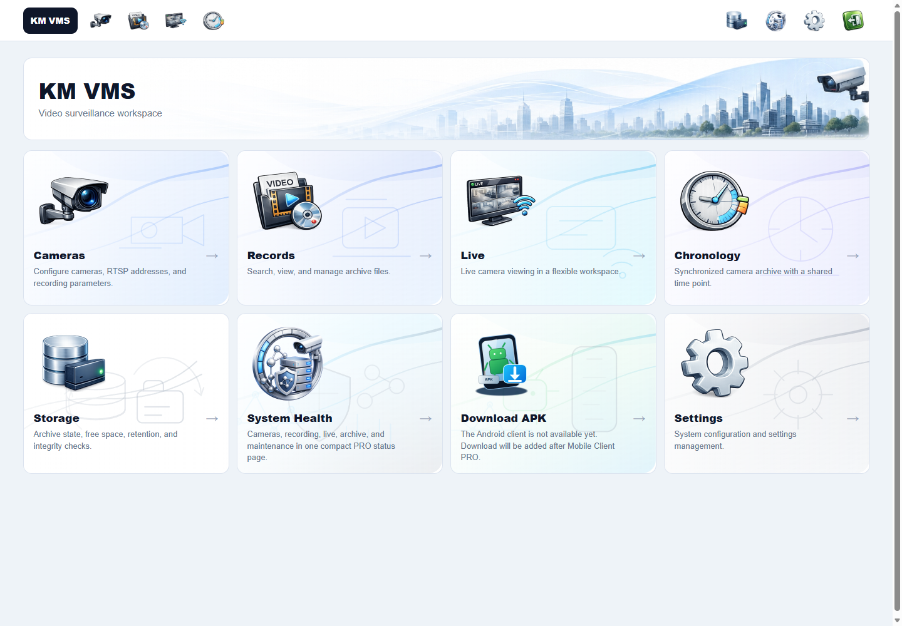
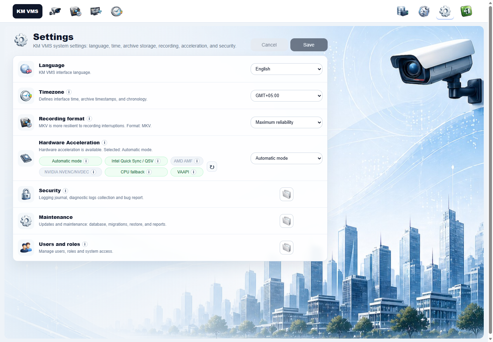

# KM VMS

## NAS-first, self-hosted video management system and network video recorder

**KM VMS is a web-based Video Management System (VMS) with Network Video Recorder (NVR) capabilities for RTSP and ONVIF IP cameras.** Run it on your own NAS or Linux server using Docker, keep your recordings on your own storage, and manage surveillance from a browser.

Designed for homes, holiday properties, homelabs, and small sites, KM VMS brings camera setup, multi-camera live viewing, recording, archive playback, storage management, and system diagnostics into one application.

**Interface languages: English · 简体中文 (Simplified Chinese) · Русский (Russian).**

[Quick start](#quick-start) · [Features](#features) · [Screenshots](#screenshots) · [Installation guide](docs/INSTALL.md) · [Releases](https://github.com/kmishnev87/km-vms/releases) · [Report a problem](https://github.com/kmishnev87/km-vms/issues)



*English interface. The Android download tile is a placeholder for a future client, not an available mobile application.*

## Why KM VMS?

- **A complete surveillance workflow.** Connect cameras, watch live video, record, find an event in the archive, and export the relevant footage without switching between unrelated tools.
- **Your server, your archive.** Video recordings stay on storage you control. Local recording and viewing do not require a camera manufacturer's cloud account or cloud recording service.
- **Standards-based camera connections.** Use RTSP streams and ONVIF services rather than restricting the entire installation to one camera brand.
- **A shared view of time.** The Chronology workspace helps you compare recordings from multiple cameras around the same event.
- **Storage management as part of the product.** Retention rules, archive limits, free-space monitoring, and integrity tools are available alongside recording and playback.
- **More visibility when something goes wrong.** System Health, recording states, audit history, and diagnostics help distinguish a camera connection problem from a storage or recording problem.
- **Everyday administration in the browser.** Manage users, camera settings, backups, and published updates through the web interface after installation.

## Features

| Area | What you can do |
| --- | --- |
| IP cameras | Add and edit RTSP/ONVIF cameras, check connections, select video sources and main/sub streams, and configure recording. |
| ONVIF video settings | Discover Media1/Media2 services, read supported encoder settings, and apply camera-provided options for codec, resolution, frame rate, and bitrate where the device exposes them. |
| Live monitoring | Build a multi-camera viewing workspace, expand individual tiles, and recover viewing after temporary connection interruptions. |
| Recording | Record video on your NAS/server, monitor recording state, and retry recovery after temporary camera or network failures while recording remains enabled. |
| Records and playback | Search and filter archive files, play recordings, download source files, and export selected video clips. |
| Synchronized chronology | Navigate a shared time point across multiple cameras and inspect archive coverage and gaps. |
| Archive management | Configure retention and size limits, inspect storage usage, and reconcile archive metadata with files. |
| Users and permissions | Separate access through user accounts, roles, and server-enforced permissions. |
| Maintenance | Create and verify database/configuration backups, inspect diagnostics, and apply published updates with preflight and post-update verification. |
| Video acceleration | Select supported server-side hardware acceleration when the host, drivers, and video format provide a usable path. |
| Localization | Switch the interface between English, Simplified Chinese, and Russian. |

ONVIF capabilities are device-dependent: a camera must expose the relevant service and supported options. RTSP compatibility, browser playback, and hardware acceleration also depend on the camera, codec, browser, and server. KM VMS does not claim compatibility with every camera or hardware combination.

## Quick start

The example below installs the published **0.9.5** release on a **new installation**. It is not an update command for an existing installation.

### 1. Prepare your NAS or Linux server

You need:

- Docker Engine **25.0+** and Docker Compose **2.20.2+**, or a compatible implementation of `healthcheck.start_interval`.
- Python 3, `curl`, a POSIX shell, archive utilities, and a working `getfacl` command.
- Permission to run Docker and write to the selected application directory.
- Network access to GitHub and the image/package registries needed for the initial downloads and Docker builds.

The installer does **not** install Docker or host packages for you. Host Node.js, npm, and Git are not required for the normal public installation.

### 2. Download and run the installer

Run these commands in the NAS/server terminal or over SSH:

```sh
curl -fsSL https://raw.githubusercontent.com/kmishnev87/km-vms/v0.9.5/scripts/install.sh -o km-vms-install.sh
sh km-vms-install.sh --branch v0.9.5
```

The interactive installer uses `$HOME/km-vms` as the default application directory and port `8088`. It asks for confirmation before creating a new application directory. To choose a persistent application directory on your NAS instead, add `--app-dir /path/to/km-vms` to the second command; replace that example path with your own.

The application directory contains configuration and application data. The video archive location is selected separately during browser setup. Initial installation includes Docker image preparation; download/build time depends on the NAS and network.

### 3. Finish in your browser

After the installer reports that setup is starting, open:

```text
http://<NAS-IP>:8088/setup
```

Follow the setup wizard to choose storage and create your owner account. There is no shipped default administrator password. Then add your cameras and configure recording.

For prerequisites, custom paths/ports, troubleshooting, and existing installations, see the [installation guide](docs/INSTALL.md). Check [GitHub Releases](https://github.com/kmishnev87/km-vms/releases) for newer published versions. The examples deliberately select an immutable release tag rather than the moving `main` development branch.

## Screenshots

These are real screenshots of KM VMS using the **English interface**. They contain no camera credentials, private camera addresses, or surveillance footage.

The dashboard shown above links camera configuration, records, live monitoring, synchronized chronology, storage, and system health in one web application.

### Settings and maintenance entry points

Language, timezone, recording format, hardware acceleration, security, maintenance, and user management are available from the settings workspace.



## Deployment and compatibility

KM VMS is a Docker-based, self-hosted application for Linux/NAS environments. Its web interface runs in the browser; no separate desktop client is required for normal use.

The current development and hardware-validation environment is a TerraMaster NAS. Other Linux-based NAS/server environments must provide the documented Docker, Compose, Python, filesystem/ACL, and storage capabilities; their vendor name alone is not a compatibility guarantee. No vendor certification or ONVIF conformance certification is claimed.

The implementation uses a Python/FastAPI backend, PostgreSQL, Redis, FFmpeg-based video processing, a Next.js web frontend, and nginx. See [dependency notes](docs/DEPENDENCIES.md) for pinned component information.

### Implemented versus planned

Live viewing, recording, records playback, synchronized chronology, retention, ONVIF video configuration, users/roles, diagnostics, backups, and update workflows are implemented.

The following are **future work**, not current product promises:

- A native mobile client.
- PTZ operator controls.
- Advanced ONVIF event workflows.
- AI video analytics and object detection.
- Multi-storage recording placement and archive tiering.

## Frequently asked questions

### Is KM VMS a VMS or an NVR?

Both descriptions are relevant. As an NVR, it records IP-camera video to server storage. As a VMS, it also manages cameras, viewing workspaces, synchronized archive navigation, users, permissions, storage policies, and diagnostics.

### Does local surveillance require a cloud service?

No camera-vendor cloud account is required for the local RTSP/ONVIF recording and viewing workflow. Installation and update downloads need internet access. Remote viewing requires you to configure a suitable network access path.

### Can I use cameras from different manufacturers?

The connection mechanisms are RTSP and ONVIF, not one manufacturer's cloud API. Actual support depends on the device's streams, services, authentication, and codec implementation. A compatible device is not automatically a tested device.

### Can I change a camera's video settings from KM VMS?

Yes, when the camera exposes the corresponding ONVIF Media1/Media2 services and encoder options. Available settings are read from the device rather than advertised as universal controls for every camera.

### How do I update an existing installation?

Use **Settings → Maintenance** to check and apply an available published update. Do not rerun the new-install command over an existing application directory. The installation guide also documents the terminal update path.

### Does a database backup include the video archive?

No. Database backups protect application metadata and configuration; video files require a separate archive-backup strategy. Retention cleanup is not a backup.

### Can I expose the web interface to the internet?

The quick start serves HTTP and is intended for initial setup on a trusted network. It does not configure HTTPS or internet access automatically. For remote use, configure a properly secured HTTPS reverse proxy or VPN and appropriate network restrictions. Never expose the Docker control socket or treat an unprotected HTTP port as a secure remote deployment.

## Project status, support, and licensing

KM VMS is actively developed. Published releases and their notes are available under [Releases](https://github.com/kmishnev87/km-vms/releases). Compatibility and capacity should be evaluated for your own cameras, NAS, storage, and network; no universal camera-count or performance guarantee is claimed.

For ordinary bugs and feature requests, use [GitHub Issues](https://github.com/kmishnev87/km-vms/issues). Include the release version, environment, expected/actual behavior, and sanitized reproduction steps. Do not publish passwords, tokens, camera URLs containing credentials, database dumps, or private video. If private vulnerability reporting is available in the repository's Security section, use it for sensitive security reports rather than disclosing details in a public issue.

No project license file has been selected at present. Repository visibility and this README are not a statement that the project has an approved open-source license; redistribution and licensing terms require a separate decision by the maintainer.
