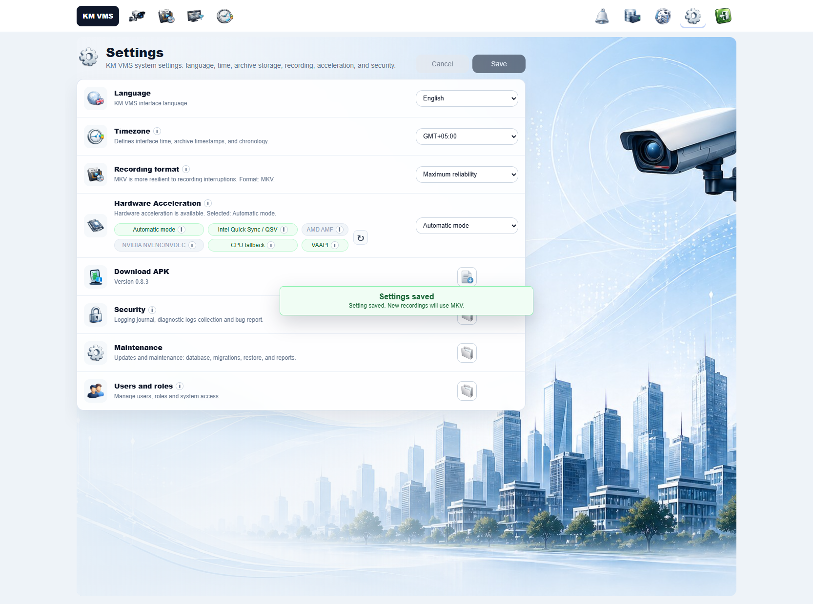
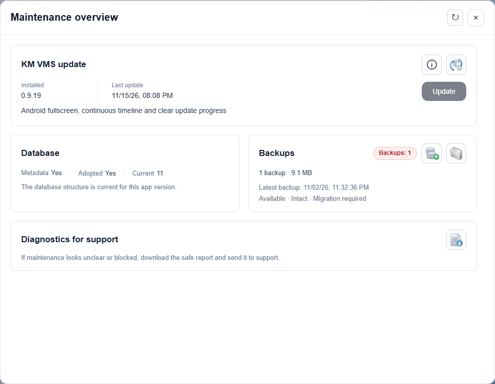

# KM VMS

## Self-hosted VMS and NVR for IP cameras — on your NAS, in your browser, and on Android

**Watch live. Investigate in sync. Keep the footage that matters.**

KM VMS is a self-hosted **Video Management System (VMS)** and **Network Video Recorder (NVR)** for **RTSP and ONVIF IP cameras**. Watch multiple cameras live, record continuously or when something happens, and investigate from a synchronized archive in your browser or the native Android app.

Run it on your own NAS or Docker-capable Linux server. Keep video on storage you control. Watch from a browser or the native Android app, control supported PTZ cameras, follow events across recordings, and export important moments. Local recording and viewing do not require a camera manufacturer's cloud account.

**Your cameras. Your archive. Your surveillance system.**

**Three interface languages: English · 简体中文 (Simplified Chinese) · Русский (Russian).**

**MIT licensed:** use, modify, and distribute the project, including commercially, with the notices required by the license.

[Quick start](#quick-start) · [Features](#what-km-vms-can-do) · [Android](#native-android-app) · [Releases](https://github.com/kmishnev87/km-vms/releases) · [Report a problem](https://github.com/kmishnev87/km-vms/issues)


## Why choose KM VMS?

### Record the moments you need, not necessarily the whole day

Choose a recording policy for each camera. Keep critical views recording continuously, use compatible camera events or local NAS AI to capture activity elsewhere, or record a second viewpoint whenever a selected camera is recording. Add pre-event footage where it matters so you can see what led up to an alert, not just what happened afterward. Local analysis does not send footage to a cloud AI service.

### One system from live viewing to saved footage

See what is happening, open the relevant recording, compare several viewpoints on a shared timeline, and export a clip with its information passport. Camera events, viewing, playback, and export are connected parts of the same workflow.

### A synchronized archive you can follow

Multiple recordings share one time point. When an available recording needs more data, the group and its clock pause together while all available sources continue buffering. A confirmed recording gap does not block the other cameras.

When following a person or vehicle across viewpoints, the sequence should not depend on which video loaded first.

### A native Android client for the same NAS

The browser provides a spacious surveillance workspace; Android provides touch-oriented controls, fullscreen video, PTZ, and notifications. Both use the same cameras, archive, events, and server-enforced permissions. Saved connections let you switch between home and a holiday property without repeatedly signing out and back in.

### PTZ built into the viewing experience

Supported PTZ controls appear after normal camera setup. Move the camera, adjust zoom and speed, or select a saved position without leaving the live view. During control, a compatible stream uses the low-latency video path so the picture can follow your actions more closely.

### Choose the live-view experience for your connection

Use **Fast** for lower-latency multi-camera viewing, or **Stable** for a larger video buffer when the connection is uneven. One NAS-wide choice serves both the browser and Android app. An incompatible stream falls back individually to HLS with a clear explanation; it does not force every camera back to the slower path or change your recording settings.

### Storage management belongs inside the VMS

Configure retention and archive limits, inspect usage by camera, check integrity, and resolve findings individually or in batches. System Health distinguishes current recording problems from findings about older files.

### Your storage stays yours

Choose the NAS or server, archive location, and retention rules. Local RTSP/ONVIF recording and viewing do not require a camera-vendor cloud subscription. Video stays on your storage and is not attached to diagnostic reports sent to the developer.

Built for homes, holiday properties, small sites, and homelabs where control over footage, convenient multi-camera operation, and independence from one camera-cloud ecosystem matter.

## Quick start

Prepare a NAS or Linux server with Docker Engine **25.0+**, Docker Compose **2.20.2+** or compatible `healthcheck.start_interval` support, Python 3, `curl`, a POSIX shell, archive utilities, and `getfacl`. The installing user needs Docker access and permission to write to the application directory.

For a **new installation** of KM VMS **[1.0.2](https://github.com/kmishnev87/km-vms/releases/tag/v1.0.2)**, run in the server terminal:

```sh
curl -fsSL https://raw.githubusercontent.com/kmishnev87/km-vms/v1.0.2/scripts/install.sh -o km-vms-install.sh
sh km-vms-install.sh --branch v1.0.2
```

The installer offers `$HOME/km-vms` and port `8088` by default. To choose another persistent application directory, add `--app-dir /path/to/km-vms` to the second command, replacing the example with your own path.

After the services are prepared, open:

```text
http://<NAS-IP>:8088/setup
```

The wizard guides storage selection and owner-account creation. There is no shipped default administrator password. Add cameras and configure recording afterward. Host Node.js, npm, and Git are not required for normal installation. Docker and host packages must be prepared beforehand; initial download/build time depends on hardware and network access.

**Already running KM VMS?** Update through **Settings → Maintenance** instead of running a new installation over the existing application directory.

[Detailed installation guide](docs/INSTALL.md) · [Latest published release](https://github.com/kmishnev87/km-vms/releases/latest)

## What KM VMS can do

### Cameras and ONVIF video profiles

- Connect IP cameras through **RTSP and ONVIF**.
- Find compatible cameras on the NAS's physical LAN, or search selected reachable private subnets across existing routes/VPNs. Confirm ONVIF/RTSP responses, see progress, stop a search, and choose the connection method without retyping an address.
- Check connections and select the appropriate lens/video source and main/sub streams.
- Discover **ONVIF Media1 and Media2** services and the device's available video profiles.
- Read and change exposed encoder settings: codec, resolution, frame rate, bitrate, and related camera-provided options.
- Handle multiple lenses on one device while respecting differences between panoramic and movable channels.
- Pause and resume recording from the camera card; configure each camera's recording policy in **AI & Recording**.

Camera controls are grounded in what the device reports. Supported settings can be managed from the VMS without opening the camera's own web interface for each adjustment.

### Multi-camera live monitoring

- View several cameras in a configurable workspace.
- Align by tile or **fit the cameras' frame aspect ratios** to use the screen more effectively.
- Add all current cameras with frame-aware alignment.
- Open individual fullscreen views with main/sub selection and audio controls.
- Double-click a camera preview to open its own frame-fitted live view without replacing your saved workspace.
- Recover viewing after temporary connection interruptions.

Select **Live mode** immediately after the recording format in web Settings or Android **NAS settings**:

- **Fast:** continuous **WebSocket/fMP4** delivery for live cameras and main/sub streams, including fullscreen. It avoids waiting for HLS video segments, reducing video delay and usually shortening startup; it is more sensitive to connection interruptions.
- **Stable — the default:** the existing buffered **HLS** route for ordinary viewing, with the low-latency route enabled for the camera whose PTZ controls are open.

Owners and administrators change this shared NAS setting; all viewers use it. Confirmed client/stream incompatibility enables HLS only for the affected stream, with an explanation beside its camera name. A temporary network error is not mislabeled as incompatibility. Recording, archive playback and synchronized chronology are independent of this choice.

### Capability-based PTZ

- Automatically discover supported PTZ functions for the selected lens.
- Pan, tilt, zoom, select speed, and move to camera-provided saved positions.
- Move the translucent fullscreen control panel to a convenient screen location.
- During PTZ control, switch the corresponding view to **low-latency WebSocket/fMP4 video** when the selected stream supports this path.
- Use point positioning and area zoom when a supported device-control path is available.

A fixed panoramic lens does not gain PTZ because another lens in the same device can move. Controls follow the selected channel's actual capabilities.

### Talk through a supported camera

From an individual live view in Android, an owner or administrator can start a **camera call** without leaving the picture. KM VMS checks for a standard **ONVIF RTSP audio backchannel** or a compatible **Tapo local-protocol** interface rather than enabling talk solely from a brand or model name.

- Hold to speak through the standard backchannel adapter; compatible Tapo sessions provide a full-duplex path with a microphone mute control.
- Use low-latency video while the call is active, preserving the existing PTZ and sound preferences afterward.
- Grant Android microphone permission explicitly. Leaving the camera, backgrounding the app, hanging up or losing the connection stops capture; calls do not keep a microphone service running in the background.
- Listen automatically when a call starts, mute listening when needed, and return to the previous listening preference on hang-up. Hold-to-speak temporarily silences incoming audio to reduce feedback.
- If Tapo requires a separate account password for local talk authentication, KM VMS verifies it before saving it encrypted on the NAS rather than on the phone. A rejected sign-in allows another attempt. Audio is forwarded in memory, not saved as a call recording.

For the Tapo local adapter, use the **TP-Link ID password used to sign in to Tapo**, not the separate RTSP/ONVIF camera account. Some firmware also requires **Tapo → Me → Third-Party Services → Third-Party Compatibility** to be enabled. A rejected sign-in does not by itself prove the password is wrong; camera access policy can also block it.

Two-way audio is device- and firmware-dependent: a camera microphone, speaker or ONVIF logo alone does not guarantee a compatible return-audio path. The initial standard adapter supports mono 8 kHz G.711 A-law/µ-law. Physical speaker/microphone performance and echo handling need validation on the actual camera and phone. **Browser microphone calling is not included in this release.**

### Recording and playback

- Record to your NAS/server, inspect Recorder state, and recover after temporary camera or network failures.
- Choose MKV or MP4 recording behavior to suit your installation.
- Verify saved fragments before calling them complete: duration, decodable video, and the MKV seek index are checked.
- Recover interrupted containers without re-encoding the video. After an abrupt Recorder/NAS restart, recover owned unfinished recordings in the background while new recording continues.
- Keep the original until a repaired file is verified and its catalog update commits; recover an interrupted repair on the next start. Missing or physically damaged footage cannot be recreated, and unconfirmed files remain available for review.
- Search and filter recordings, play them, download source files, and confirm deletion explicitly.
- Keep retained footage from removed cameras accessible under their original names, clearly marked as removed.

### AI & Recording

The **AI & Recording** workspace in the browser and Android manages policies on the same NAS. You choose which cameras to analyze and which to leave on continuous recording.

- Keep continuous recording with optional analytics, record when compatible camera events or local AI rules trigger, or record a second view during the actual recording of an explicitly linked camera. This can pair two lenses of one device or two separate cameras.
- Choose **Economical** for camera-triggered recording without a prebuffer, **Balanced** for a lower-bandwidth prebuffer that switches to recording quality, or **Full quality** to retain the configured recording stream before the trigger. Local AI uses Balanced or Full quality; it does not open a separate video stream just to analyze it.
- Detect people, vehicles and supported animals on the NAS. Draw zones and directional lines on a camera frame; set dwell, exclusions and schedules. Choose which rules trigger recording and which notify you.
- Browse AI snapshots and rule details in the same event history as camera events. Open the matching archive when it exists, save a separate clip, or label a false positive without changing the model.
- Choose whether event-based cameras temporarily record continuously if their detection source fails. This protection is off by default. A manual pause, unavailable video or unavailable storage still takes priority.

Local analysis works without cloud inference. It uses a compatible Intel GPU when available and a bounded CPU fallback otherwise. Capacity and detection depend on the NAS, streams and scene. Face recognition and plate reading are not included. See [AI & Recording: setup and limits](docs/AI-RECORDING.md).

### Synchronized chronology

- Navigate a shared time point across cameras.
- Use 3-, 6-, 12-, and 24-hour views and 3- or 7-day views in the browser.
- On Android, pan and zoom a touch-friendly ruler into shorter intervals.
- Pan across calendar days on Android, with archive ranges loaded for the visible dates in the NAS timezone.
- Start available recordings together and pause the group when buffering is required.
- Adapt the recovery buffer after real data starvation without imposing a fixed extra delay on a fast first start.
- On Android, prioritize current playback reads over speculative prefetch and reuse scoped media authorization within a playback session, without a separate three-camera/read bottleneck.
- Hold the last frame while the next segment loads.
- Navigate event markers and manually add removed cameras with retained recordings.

This is a common time-based workspace for investigating footage, not just a grid of unrelated playback controls. It still requires enough sustained bandwidth for the selected recordings; buffering cannot create bandwidth that is not available.

### Clips and important moments

- Create clips from Records or Chronology, including footage from removed cameras.
- Select up to three hours without a fixed 4 GiB source-size cap; preparation checks available storage.
- Download the resulting video and its clip-information passport.
- Browse saved clips with file size and playback duration, and explicitly delete derived results.
- Deleting a clip does not delete its source recordings. Original footage follows separate retention rules.

### Camera events and notifications

Receive ONVIF events from compatible cameras, keep a searchable history, and move from an event to its video. KM VMS recognizes eleven useful categories:

**Motion, person, vehicle, animal, zone intrusion, line crossing, loitering, tampering, sound, wrong direction, and smoke/flame.**

- Control shared event reception from camera setup or a dedicated per-camera reception list.
- Select personal notifications by camera and event type, with shared or individual camera schedules in the NAS time zone.
- Retain muted arrivals in history as viewed, without new alert badges or push notifications. Existing unviewed events keep their status.
- Open live video or available recordings around an event; keep event markers visible even when that moment was not recorded.
- Keep service chatter, such as clock synchronization, out of detection history.
- Suppress matching repeats less than **45 seconds** apart in event history and alerts. Each repeat advances the sliding interval; cameras, rules, types and reported object classes have independent intervals. Suppression does not prevent an active recording from being extended.
- Quiet ordinary alerts on the client already visibly playing that camera, without globally muting other devices or distinct critical alarms.
- Mark events viewed, select matching events across pages, and confirm history deletion without deleting footage.

History can contain both camera detections and events created by NAS AI. Filter by source, object or rule. Opening an event uses available footage; it cannot recreate a recording that was never made.

### Storage and System Health

- Configure archive retention and size limits.
- Edit segment length, retention days, and archive limits for several cameras in one compact Storage dialog. Apply shared values to selected cameras and save the changed rules together, with conflict checks before any are committed.
- Inspect free space, archive roots, and recorded volume by camera.
- Filter archive-integrity findings by camera, cause, time, and state.
- Confirm individual or bulk actions.
- Review operation history with grouped stages and a distinction between an earlier failed attempt and the issue's current state.
- Separate current recording problems from findings about old files: a historically damaged recording does not by itself mean that recording has stopped now.

### Administration and maintenance

- Manage users, roles, and server-enforced permissions.
- Create database/configuration backups and verify restoration.
- Apply published releases through the interface, with preflight checks, managed schema migration, installed-release verification, and rollback support.
- Collect diagnostics and explicitly consent to sending a report to the developer, with acknowledgement after acceptance.
- Use optional hardware acceleration when compatible devices and drivers are available. **A GPU and `/dev/dri` are not required for installation**; software processing is supported.

A database backup is not a video-archive backup. Footage needs its own backup strategy.





## Native Android app

KM VMS for Android is a **native client, not a desktop page wrapped in a WebView**. It shares the product's artwork and visual language while providing phone-oriented controls.


- **Android 8.0 and later.**
- English, Simplified Chinese, and Russian.
- Multiple saved NAS connections with independent sessions.
- A live camera feed list, fullscreen viewing, main/sub selection, audio, and pinch/pan image gestures.
- Swipe between cameras on the individual Live or fullscreen Chronology view, wrapping from the last back to the first. A zoomed image pans instead; switching viewpoints in Chronology keeps the shared playback running.
- Capability-based camera calls for owners and administrators, with explicit microphone permission and automatic cleanup when leaving or backgrounding the live view.
- Tap a camera-card preview to watch only that camera. Rotation and fullscreen keep the single-camera session until you leave Live.
- Choose a subset of live cameras in a compact, dismissible panel. Selection numbers and drag-to-reorder control the viewing order; each saved NAS/account connection keeps its normal set independently of temporary single-camera viewing.
- Fast/Stable live mode shared with the browser, editable in **NAS settings** under the same server-enforced permissions; supported PTZ still uses low-latency viewing during control.
- Recordings, clips, synchronized chronology, camera management, events, AI & Recording, storage, server health, and NAS maintenance.
- Select timeline cameras in the order you need, then drag to reorder them; retained archives of deleted cameras remain available for manual selection.
- Access camera presets in fullscreen PTZ control. Swipe recordings to reveal deletion; confirm removal individually or for the selected group.
- Add, edit, enable, disable and delete NAS user accounts and assign supported roles from the phone, under the same server-enforced permissions and owner protections as the browser.
- A notification setup offer after the first NAS login, with a separately remembered choice for each server.
- Notifications that open the corresponding server, camera, and event.
- Two optional home-screen notification widgets: compact 2×1 quick controls, or 3×1 with separate taps for alert settings, Live and the unread count that opens event history. Both are bound to your chosen NAS/account. Schedules remain in force; recording and event reception are unchanged. Count changes use silent push, not background NAS polling.
- Built-in app diagnostics: add a comment and send a client report directly to KM VMS support from Settings. No ZIP needs to be created, saved, or shared on the phone; the support server confirms acceptance with a report number.
- APK checks on the first foreground opening in a new day, plus manual checks. Before installation, the client checks size, hash, package, version, and signing certificate. Android asks for installation confirmation.
- NAS update checks start when you enter the Android maintenance screen. Follow server-reported stages and the current operation; APK downloads show transferred bytes and a measured percentage, followed by a separate verification step.

Background alerts use a compatible **UnifiedPush provider**, not continuous NAS polling. Delivery can use supported Google-service infrastructure or a separately installed distributor such as ntfy. Android notification permission, an available delivery service, network access, and suitable device battery settings are required. Video and archive viewing do not depend on push being enabled.

The private, bounded app journal distinguishes receipt, parsing, Android posting, and intentional suppression of a notification. Diagnostics exclude passwords, tokens, camera images, video, and raw push packets. Sending is explicit, not automatic telemetry. For NAS/server problems, send the separate server report from the web interface.

Download the APK from **Settings → Download APK** in the NAS web interface or [GitHub Releases](https://github.com/kmishnev87/km-vms/releases). APK information is bundled with the NAS release. NAS and Android version numbers are independent; use the official signed APK to update an installed client.

## Architecture and compatibility

The server uses **Python/FastAPI, PostgreSQL, Redis, and FFmpeg**. The web client uses **Next.js**, with **nginx** handling incoming web traffic. Android uses **Kotlin, Jetpack Compose, and Media3**. Server services are deployed through Docker Compose.

RTSP provides video streams; ONVIF exposes supported sources, profiles, PTZ, events, and configuration. This supports installations built from compatible devices across manufacturers rather than tying the entire product to one camera cloud.

The current primary hardware-validation environment is a TerraMaster NAS. Other Linux/NAS installations must provide the documented Docker, filesystem, and storage capabilities. Compatibility depends on the services, streams, and platform, not just a manufacturer's name. H.265 playback, audio, acceleration, and individual PTZ functions depend on the camera, codec, and client. Universal compatibility and ONVIF certification are not claimed.

For remote access, configure a secured HTTPS reverse proxy or VPN. Initial HTTP setup does not issue a certificate or configure internet access automatically. Android supports HTTP with an explicit warning and HTTPS with normal certificate verification.

## Project development

The [release history](https://github.com/kmishnev87/km-vms/releases) documents what shipped in each version. Start with the [AI & Recording guide](docs/AI-RECORDING.md) for the recording policies, local rules and troubleshooting added in 1.0.2.

Assigning recordings from individual cameras to specific storage devices is not currently supported.

## Feedback and diagnostics

To report a problem, open **Settings → Security**, describe it, and select normal or extended diagnostics. Sending requires explicit consent and uses HTTPS; the application shows a report ID after acceptance. You can download the diagnostic ZIP instead.

Video recordings are not included. Diagnostics may contain device names, addresses, and application state; known secret fields are redacted. Do not type passwords into the description or publish diagnostic archives openly.

Use [GitHub Issues](https://github.com/kmishnev87/km-vms/issues) for suggestions and sanitized bug reports. For sensitive vulnerability information, use a private channel if available in the repository's Security section.

## License

KM VMS project code is available under the [MIT License](LICENSE). Use, modify, and distribute it, including in commercial projects, subject to the license terms. Third-party components retain their own licenses; see [dependency notes](docs/DEPENDENCIES.md). The software is provided without warranty as stated in the license.

**KM VMS — watch what is happening, understand what happened, and manage the system on your own server.**
