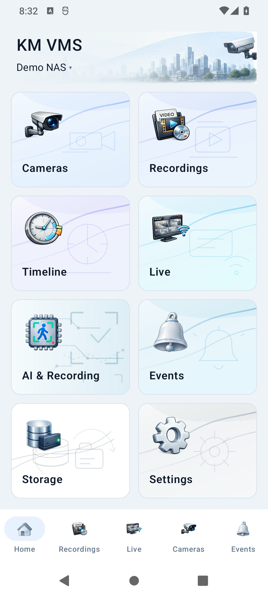

# KM VMS

**Self-hosted video monitoring and recording for RTSP and ONVIF cameras.** Watch cameras live, capture the activity that matters, and follow it through synchronized footage on your NAS. The web workspace and native Android app share the same cameras, archive, events, and user permissions.

Run KM VMS on your NAS or Docker-capable Linux server, with storage and retention under your control. Local recording, viewing, and NAS AI do not require a camera vendor's cloud service.

[Quick start](#quick-start) · [Features](#features) · [Android](#native-android-app) · [Releases](https://github.com/kmishnev87/km-vms/releases) · [Report an issue](https://github.com/kmishnev87/km-vms/issues)


## Quick start

Prepare **Docker Engine 25.0+**, **Docker Compose 2.20.2+** (or compatible `healthcheck.start_interval` support), Python 3, `curl`, a POSIX shell, archive utilities, and `getfacl`. The installing user needs Docker access and a writable application directory.

For a new installation, run on the NAS or Linux server:

```sh
curl -fsSL https://raw.githubusercontent.com/kmishnev87/km-vms/v1.0.4/scripts/install.sh -o km-vms-install.sh
sh km-vms-install.sh --branch v1.0.4
```

Open `http://<NAS-IP>:8088/setup` on your trusted network, choose storage, and create your owner account. KM VMS ships without a default administrator password. Host Node.js, npm, and Git are not required for normal installation.

**Already installed?** Update through **Settings → Maintenance** instead of running a fresh install over the same directory.

[Installation and maintenance guide](docs/INSTALL.md) · [Latest published release](https://github.com/kmishnev87/km-vms/releases/latest)

## Features

### Connect cameras and see what is happening

- Find compatible cameras on the local network or search selected reachable private subnets over existing routes or VPNs. Add devices via **RTSP or ONVIF**, verify connections, choose a lens and the streams used for recording and preview, and adjust camera-provided encoder settings where supported.
- Arrange several live views by tile or frame aspect ratio. Open a camera card's preview as its own live view, or view a camera fullscreen with main/sub and sound controls.
- Choose **Fast** for low-delay live viewing or **Stable** for a larger buffer on uneven connections. This NAS-wide setting serves both clients and does not change recordings. Confirmed incompatibility in Fast mode falls back to HLS for the affected stream only.
- Control supported PTZ lenses in Live: movement, zoom, speed, saved positions, and point or area controls where supported. The controlled view tries the low-latency path during PTZ operation. A fixed lens does not inherit controls from a moving lens on the same device.

### Record continuously, on activity, or from a second viewpoint

- Choose a policy **per camera** in **AI & Recording**: continuous with or without analytics, event-based, or linked recording that follows a camera or lens you explicitly select. Pause or resume recording from the camera card without losing its policy.
- Use compatible **ONVIF detections** or **local NAS AI** as the event source. Choose **Economical** (camera events, no prebuffer), **Balanced** (preview prebuffer, then recording stream), or **Full quality** (recording stream prebuffer). These profiles use your configured streams, not the camera vendor's channel names.
- Detect people, vehicles, supported animals, and major scene changes locally. Draw directional lines, zones, and exclusions on a reference frame; configure timing and schedules. Edit rules in the fullscreen web editor and see saved contours in Live. Day/night lighting does not invalidate fixed-camera geometry; spatial rules on moving cameras require the configured viewpoint.
- Opt in to temporary emergency recording during a confirmed detection-source failure. **System Health** reports the problem; ordinary silence is not an outage. Choose MKV or MP4. KM VMS verifies recordings and can recover unfinished files after an interruption or a sudden restart when the written data is usable.

[Recording profiles, AI rules, and their limits](docs/AI-RECORDING.md)

### Investigate in sync and save useful footage

- Search, play, download, or delete original recordings. Retained footage from removed cameras is still available under its original camera name.
- Scrub **Chronology** to a shared time across cameras. A confirmed gap on one camera does not pause the others. When data is late, available recordings buffer together and resume in sync. Zoom into shorter time ranges or move across days.
- Go from a detection to Live or the matching archive when it exists. Event markers remain visible without video. Filter history by camera, time, source, type, or AI rule.
- Export clips up to three hours from Recordings or Chronology, including retained footage from removed cameras. Saved clips show duration and size and include downloadable clip information. Deleting a clip does not delete the source footage.

### Get one alert when an episode starts

- The **first matching detection** starts an episode and can alert you immediately, even if the recorder has not opened a file. Further matching activity on that camera extends the episode without adding more history rows, badges, or pushes. For event recording this follows the recording window. For continuous recording with analytics, set **After** to one to five quiet minutes; it changes alerts, not the video.
- Choose which cameras notify **you**, and when, separately from how they record. Use shared or individual schedules in the NAS time zone. Muted arrivals remain in history as viewed; existing unread events keep their status.
- Acknowledge or delete history entries, including filtered selections across pages. Android notifications can include a preview and distinct Live and Recording actions.

### Run and maintain your own system

- Review free space, archive roots, and per-camera usage. Set segment length, retention, and size limits individually or edit several cameras together. Inspect current recording health and older integrity findings separately, with individual and bulk actions.
- Manage users and roles with server-enforced permissions. Create a configuration/database backup with an automatic trial restore into a temporary database. Video archives need their own backup.
- Apply published NAS releases with preflight, migration, activation verification, and rollback support. Explicitly send redacted diagnostics or download a report for review; reports do not attach video recordings.

## Native Android app



**Android 8.0 or later.** Save several NAS connections and switch between them without signing out. Both interfaces support English, Simplified Chinese, and Russian.

- Choose and reorder cameras, open fullscreen video, pinch to zoom, and swipe between cameras. In Chronology, changing the selected camera does not pause shared playback. Access recordings, clips, events, AI & Recording, storage, users, and NAS maintenance subject to your account permissions.
- Talk through supported cameras via an **ONVIF audio backchannel** or a compatible **Tapo local interface**. Android requests microphone permission. Standard backchannel uses hold-to-speak; compatible Tapo calls support full duplex. Browser microphone calling is not included. See [setup and compatibility](docs/INSTALL.md).
- Receive background alerts through a compatible **UnifiedPush** provider, without continuous NAS polling. The optional **2×1** widget opens quick alert controls; **3×1** adds a Live shortcut and the unread count. Widgets honor personal schedules and do not change recording.
- Download the official signed APK from **Settings → Download APK** on your NAS or from [GitHub Releases](https://github.com/kmishnev87/km-vms/releases). Follow NAS update stages and measured APK download progress. The client verifies the APK before Android requests installation approval.
- Send an optional Android diagnostics report with a comment directly from the app, without saving a ZIP on the phone. For NAS problems, send the separate web diagnostics report.

## Compatibility and privacy

TerraMaster is the main NAS validation platform. Other NAS/Linux systems need the documented Docker, filesystem, and storage support. ONVIF features, codecs, PTZ, camera audio, and hardware acceleration depend on the camera, streams, and client. A GPU is not required: local AI can use a compatible Intel GPU or a bounded CPU fallback. Check your NAS load before analyzing several cameras. Face recognition and plate reading are not included.

Use a trusted LAN for HTTP or secured HTTPS or a VPN for remote access. The installer does not publish the NAS on the internet or issue a certificate. Android accepts a local `IP:port` address, warns before using unencrypted HTTP, and checks HTTPS certificates normally.

[Setup and troubleshooting](docs/INSTALL.md) · [Dependencies and licenses](docs/DEPENDENCIES.md) · [Maintainer release workflow](docs/RELEASING.md)

Use [GitHub Issues](https://github.com/kmishnev87/km-vms/issues) for suggestions and sanitized bug reports. Do not share passwords, diagnostic archives, or private camera details in public issues.

KM VMS code is [MIT licensed](LICENSE). Third-party components retain their own licenses.
