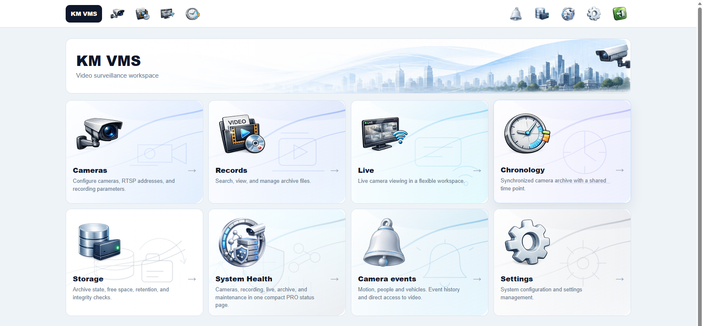

# KM VMS

**A self-hosted video management system (VMS) and network video recorder (NVR) for RTSP and ONVIF IP cameras. Record continuously or trigger recording with events from your cameras or local AI analytics.**

Bring cameras from different manufacturers into one system on your NAS or Linux server. Watch live in the browser or the native Android app, and use a shared timeline to see what happened from more than one angle. Your footage stays on the storage you choose. Local recording, viewing, and AI don't require a camera manufacturer's cloud service.

[Install on your NAS](#quick-start) · [Download the Android APK](https://github.com/kmishnev87/km-vms/releases/download/v1.0.4/km-vms-android-0.8.16.apk) · [Why KM VMS](#why-km-vms) · [Compatibility](#compatibility) · [Complete feature map](#complete-feature-map)



## Why KM VMS

### Follow an event across cameras, then save just the clip you need

Someone comes through the gate. Open the alert to check the camera live, or jump to the event in the archive when footage is available. Add the other cameras to **Chronology** and play them on the same timeline: see where the person came from and where they went without lining up recording files by hand. If one camera has a gap, the others keep playing.

The timeline distinguishes event markers from recorded footage. You can also revisit footage from a camera you've removed, as long as its archive was kept. Export the relevant time range as a separate clip without changing the originals. If you need a record of what you exported, download the clip manifest with its source, time range, and checksum.

### Choose what each camera records — including what happened before the trigger

Keep a critical view recording continuously, let another camera start recording from its own detections, and use local AI for a third. You can link a second camera to a selected source's recording window, too: for example, keep the wide shot and the PTZ view of the same incident even if only one lens reports the event.

Choose an event recording profile based on the lead-up you want to keep and how much bandwidth you want to use:

- **Economy:** For events sent by the camera, open the recording stream only when an event arrives. There is no pre-event footage.
- **Balanced:** Save the lead-up from the lighter viewing stream, then switch to the selected recording stream when the event starts.
- **Full quality:** Buffer the selected recording stream so the lead-up is saved at recording quality as well.

Set how long to record after the last matching event. New activity extends the same recording, so it doesn't cut off in the middle of an incident. The viewing and recording streams are the ones you assign to each camera.

### Make local AI look for what matters to you

Draw a zone around your driveway and leave out the road, or draw a line at the gate and detect a person crossing in one direction. Choose which objects matter to each rule — people, vehicles, or supported animals. A rule can also react when an object stays in an area for a set time, or detect a major scene change.

Edit rules on a camera frame. In the web editor you can work fullscreen and still reach the rule controls. On supported views, turn on the saved outlines in Live to check where your rules are drawn, then hide them for a clean picture. Analysis runs on your own server; a dedicated graphics card isn't required.

### Get one alert for the episode, not one for every repeat

The first matching event opens an episode and generates an alert. Further activity extends the episode without sending another alert. With continuous recording and analytics, you can set how much quiet time must pass before the next event starts a new episode.

Pick the cameras and hours you want to hear from, for all cameras together or camera by camera. Mute an indoor camera while you're working in the room: the NAS can keep detecting and recording, and the event history stays available without adding new unread alerts for that camera while it's muted.

### Watch and control cameras without changing tools

Build a multi-camera view, open a single camera fullscreen, and switch between its Main and Sub streams without leaving the view. Pick **Fast** live viewing when low latency matters or **Stable** for more buffering on an uneven connection. This is a server setting shared by web and Android; a stream that can't use Fast can fall back individually without switching the other cameras.

Use supported PTZ controls and camera presets from Live. When you're at the door or away from home, use Android to talk through a compatible camera. Discover compatible cameras on your local network or selected reachable private subnets, or add them by address.

### Know what is recording, what needs attention, and where the video goes

Set retention and archive size per camera or edit several cameras' rules together. System Health shows whether a camera is recording, waiting for an event, paused, or having a problem. For event-based recording, you can opt into continuous recording when a camera event feed or local AI is confirmed to have failed and video is still available. An ordinary quiet period isn't treated as a failure.

KM VMS can recover usable unfinished recordings after an interruption. Give other users the access they need with server-enforced roles. Manual configuration and database backups get an automatic trial restore; video files are backed up separately. Apply NAS updates from Settings with preflight checks, post-update verification, and rollback support.

## Native Android app

[**Download the signed APK**](https://github.com/kmishnev87/km-vms/releases/download/v1.0.4/km-vms-android-0.8.16.apk) for **Android 8.0 or later**, or get it on your NAS under **Settings → Download APK**. Save more than one NAS connection and switch between them. Choose which cameras to watch, swipe between them in fullscreen, or pinch to zoom. In Chronology, changing the fullscreen camera doesn't pause shared playback. Manage supported NAS settings within your account's permissions.

From the home screen, use the **2×1 widget** to change alert settings by camera, or the **3×1 widget** to also open Live or jump to events from the unread count. Expand an Android alert to see the event image when available and choose Live or Recording. Background alerts use a compatible UnifiedPush provider without continuous polling by the app.


## Quick start

Use a compatible NAS or Linux host with Docker Engine **25.0+**, Docker Compose **2.20.2+** (or compatible `healthcheck.start_interval` support), and the [required host utilities and permissions](https://github.com/kmishnev87/km-vms/blob/v1.0.4/docs/INSTALL.md#before-you-start). You do not need Node.js, npm, or Git on the host for a normal installation.

1. **Install the published release** on the server:

   ```sh
   curl -fsSL https://raw.githubusercontent.com/kmishnev87/km-vms/v1.0.4/scripts/install.sh -o km-vms-install.sh
   sh km-vms-install.sh --branch v1.0.4
   ```

2. **Open `http://<NAS-IP>:8088/setup`** on a trusted network. Choose where to keep the archive and create your owner account. There is no default administrator password.
3. **Add a camera** in Cameras, verify its picture in Live, and choose a recording policy in **AI & Recording**.

**Already installed?** Use **Settings → Maintenance** to update. Do not run the new installation command over your existing directory.

[Installation and maintenance guide](https://github.com/kmishnev87/km-vms/blob/v1.0.4/docs/INSTALL.md) · [All releases](https://github.com/kmishnev87/km-vms/releases)

## Compatibility

- **Server.** Compatibility has been verified on Intel platforms. Local AI can run on a CPU or on compatible Intel integrated graphics. Capacity depends on your streams, recording choices, and analysis workload.
- **Cameras.** Connect compatible fixed, PTZ, and multi-lens IP cameras over RTSP or ONVIF. ONVIF events, encoder settings, PTZ, and two-way audio depend on the device and its firmware. Microphone calling is supported in Android with compatible cameras.
- **Network.** Use HTTP on a trusted local network. For remote access, use a VPN or HTTPS through a secured reverse proxy. Android accepts a local `IP:port` address, warns before connecting over unencrypted HTTP, and verifies HTTPS certificates. The installer doesn't open your NAS to the internet or issue a certificate.
- **Languages.** The web and Android interfaces are available in English, Russian, and Simplified Chinese.

[Camera setup and compatibility notes](https://github.com/kmishnev87/km-vms/blob/v1.0.4/docs/INSTALL.md#4-add-cameras-and-choose-your-language)

## Documentation and support

- [Install, update, and troubleshoot](https://github.com/kmishnev87/km-vms/blob/v1.0.4/docs/INSTALL.md)
- [Set up recording profiles and local AI rules](https://github.com/kmishnev87/km-vms/blob/v1.0.4/docs/AI-RECORDING.md)
- [Report a bug or suggest an improvement](https://github.com/kmishnev87/km-vms/issues)

Diagnostic reports are sent only at your request. Server reports don't contain video recordings; the Android app sends its own diagnostics separately. Keep credentials and private diagnostic archives out of public issues.

KM VMS code is [MIT licensed](https://github.com/kmishnev87/km-vms/blob/v1.0.4/LICENSE). [Third-party components retain their own licenses](https://github.com/kmishnev87/km-vms/blob/v1.0.4/docs/DEPENDENCIES.md).

## Complete feature map

Reference for [NAS 1.0.4 and Android 0.8.16](https://github.com/kmishnev87/km-vms/releases/tag/v1.0.4): 515 entries in 21 tables. Each row describes an action, setting, or visible behavior. Some actions are available in more than one workspace. Availability can depend on your role, client, and camera capabilities.

### Installation and first launch

<details>

<summary>Show 22 functions</summary>

| No. | Function |
|---:|---|
| 1 | Install a self-hosted VMS/NVR on a compatible NAS or Linux server with Docker. |
| 2 | Choose a specific published release to install. |
| 3 | Choose a persistent application directory on the NAS. |
| 4 | Set a custom web interface port. |
| 5 | Choose a separate Docker project name during deployment. |
| 6 | Review the installation plan without changing the server. |
| 7 | Check host utilities, Docker permissions, and the installation path before proceeding. |
| 8 | Deploy and start the required application services. |
| 9 | Open the guided setup wizard in a browser. |
| 10 | Choose the interface language during setup. |
| 11 | View available volumes and their free space. |
| 12 | Select a recommended volume for the archive. |
| 13 | Enter another existing archive root manually. |
| 14 | Preview the resolved archive path before applying it. |
| 15 | Check that the archive directory is writable. |
| 16 | Create an archive directory or select an existing one. |
| 17 | Apply the archive location and monitor its activation. |
| 18 | Create an owner account with your own username and password; there is no factory password. |
| 19 | Choose the NAS time zone. |
| 20 | Choose the initial recording format: MKV or MP4. |
| 21 | Review the selected settings before completing setup. |
| 22 | Finish first-time setup and close access to the initial setup wizard. |

</details>

### Cameras

<details>

<summary>Show 45 functions</summary>

| No. | Function |
|---:|---|
| 1 | Add a compatible camera via RTSP. |
| 2 | Add a compatible camera via ONVIF. |
| 3 | Enter the address, port, and credentials manually. |
| 4 | Set a custom ONVIF service path. |
| 5 | Specify a reachable RTSP address and port separately from the ONVIF endpoint. |
| 6 | Set the paths to the main and secondary RTSP streams. |
| 7 | Choose TCP or UDP for RTSP transport. |
| 8 | Discover ONVIF cameras on the NAS's local network. |
| 9 | Find responding RTSP devices in the selected network. |
| 10 | Discover cameras on reachable private subnets over existing network routes or a VPN. |
| 11 | Select a detected subnet or enter a private address or range manually. |
| 12 | Specify additional discovery ports. |
| 13 | Monitor discovery progress by checked addresses. |
| 14 | Stop discovery and review the results collected so far. |
| 15 | Fill the camera form from a discovered device. |
| 16 | Check the connection before saving the camera. |
| 17 | Read the manufacturer, model, firmware version, and other information exposed by the device. |
| 18 | Read available ONVIF Media1 and Media2 profiles. |
| 19 | Select a specific lens or channel on a multi-lens camera. |
| 20 | Get suggested stream assignments when the camera exposes enough information. |
| 21 | Assign any suitable stream as the main recording stream. |
| 22 | Assign a different stream for ordinary live viewing. |
| 23 | Use one stream for both recording and viewing. |
| 24 | Check Main and Sub independently. |
| 25 | Preview a test frame from the selected stream. |
| 26 | See the detected resolution, codec, and video properties. |
| 27 | Check whether audio is present and inspect its available properties. |
| 28 | Repeat the test after changing the connection or stream. |
| 29 | Save the camera explicitly as unverified if the check does not pass. |
| 30 | Read the current encoder settings of the selected profile. |
| 31 | Change a supported video codec or codec profile. |
| 32 | Change the resolution when the camera allows it through ONVIF. |
| 33 | Change the frame rate. |
| 34 | Change the bitrate mode where the camera provides a choice. |
| 35 | Change the bitrate limit. |
| 36 | Change encoding quality or the keyframe interval where supported. |
| 37 | Read back applied settings to confirm that the camera accepted them. |
| 38 | See a warning when multiple profiles share the same encoder settings. |
| 39 | Edit a saved camera connection. |
| 40 | Switch the web camera catalog between a list and cards. |
| 41 | See a preview, address, protocol, and recording state on the camera card. |
| 42 | Open an individual live view from a preview: double-click in the web app or tap in Android. |
| 43 | Pause and resume recording from the camera card without resetting its policy. |
| 44 | Remove a camera from the system while retaining its archive. |
| 45 | Remove a camera and its recordings through a separate confirmed action. |

</details>

### Recordings

<details>

<summary>Show 27 functions</summary>

| No. | Function |
|---:|---|
| 1 | Open the catalog of saved recordings. |
| 2 | Filter recordings by camera. |
| 3 | Filter recordings by date. |
| 4 | Browse recordings from all cameras or all dates. |
| 5 | Find a removed camera's recordings in a separate group. |
| 6 | See recording time and file size. |
| 7 | See the number and total size of matching recordings. |
| 8 | Refresh the list manually. |
| 9 | Sort recordings by file size in the web app. |
| 10 | Change the web catalog's page size. |
| 11 | Jump to a specific page of recordings. |
| 12 | Open the selected recording for playback. |
| 13 | Play and pause a recording. |
| 14 | Seek within a recording on the playback bar. |
| 15 | See the elapsed time and total duration in the player. |
| 16 | Turn recording audio on or off. |
| 17 | Watch recordings fullscreen; the Android app opens them fullscreen by default. |
| 18 | Pinch to zoom into a recording on Android. |
| 19 | Remember the playback position when closing an unfinished recording on Android. |
| 20 | Replay a recording from the beginning after it ends. |
| 21 | Download the original recording file from the web app. |
| 22 | Delete an individual recording after confirmation. |
| 23 | Swipe a recording card on Android to reveal the delete action. |
| 24 | Select and delete multiple recordings in one operation. |
| 25 | Prepare and confirm the deletion of all recordings for one camera in the web app. |
| 26 | Prepare and confirm deletion of the entire recording archive in the web app. |
| 27 | See which files a bulk deletion removed, skipped, or could not process. |

</details>

### Live view

<details>

<summary>Show 31 functions</summary>

| No. | Function |
|---:|---|
| 1 | Watch multiple cameras at the same time. |
| 2 | Add an individual camera from the list to the workspace. |
| 3 | Drag a camera from the list to a specific workspace position in the web app. |
| 4 | Add all cameras at once with a layout fitted to their frame aspect ratios. |
| 5 | Remove a camera from the workspace without deleting it from the system. |
| 6 | Clear the entire workspace in one action. |
| 7 | Choose a subset of cameras to watch on Android. |
| 8 | See the order of selected cameras on Android. |
| 9 | Change the camera order without selecting the cameras again. |
| 10 | Move camera tiles in the web workspace. |
| 11 | Resize an individual tile. |
| 12 | Bring a selected tile to the front. |
| 13 | Arrange cameras in an equal-sized grid. |
| 14 | Arrange cameras according to their frame aspect ratios. |
| 15 | Keep your web live-view layout for the next sign-in. |
| 16 | Collapse the camera sidebar. |
| 17 | Open the entire web workspace in fullscreen. |
| 18 | Open a single camera in fullscreen. |
| 19 | Return to the previous view when leaving fullscreen. |
| 20 | Stay in single-camera mode on Android until leaving that live view. |
| 21 | Switch between Main and Sub while viewing, including in fullscreen. |
| 22 | Turn camera audio on or off during live viewing. |
| 23 | See the camera name before its first frame loads. |
| 24 | Pinch to zoom and pan the enlarged image on Android. |
| 25 | Swipe through cameras in either direction, wrapping around the list, in the Android individual view. |
| 26 | Pan a zoomed image by swiping without switching cameras. |
| 27 | Choose Fast for lower viewing latency or Stable for a larger buffer. |
| 28 | Automatically fall back to HLS for an incompatible stream without switching the other cameras. |
| 29 | Show why a stream fell back to HLS. |
| 30 | Reconnect temporarily interrupted live views. |
| 31 | Show saved AI outlines on demand on an eligible live camera. |

</details>

#### Live view → PTZ controls

<details>

<summary>Show 13 functions</summary>

| No. | Function |
|---:|---|
| 1 | Detect PTZ support for the selected lens. |
| 2 | Open PTZ controls over the live view. |
| 3 | Pan the camera horizontally. |
| 4 | Tilt the camera vertically. |
| 5 | Move diagonally when the selected lens supports it. |
| 6 | Zoom in and out optically. |
| 7 | Adjust movement speed. |
| 8 | Stop camera movement. |
| 9 | Recall a camera preset, including from fullscreen on Android. |
| 10 | Aim the camera at a point in the picture where supported. |
| 11 | Select an area to aim and zoom into. |
| 12 | Move the floating controls in the fullscreen web view. |
| 13 | Switch the controlled camera to a compatible low-latency view when opening the controls. |

</details>

#### Live view → two-way camera audio on Android

<details>

<summary>Show 14 functions</summary>

| No. | Function |
|---:|---|
| 1 | Start talking through a compatible camera from its live view. |
| 2 | Check for a compatible audio backchannel. |
| 3 | Ask for Android microphone permission when using talk. |
| 4 | Hold a button to speak through the standard backchannel. |
| 5 | Talk and listen simultaneously on compatible devices with the appropriate adapter. |
| 6 | Mute the microphone during a call. |
| 7 | Turn incoming camera audio on or off during a call. |
| 8 | Automatically turn on incoming audio when the call starts. |
| 9 | Restore the previous audio setting after ending the call. |
| 10 | Verify separate camera talk credentials before saving them on the NAS. |
| 11 | Re-enter the password after an authentication failure. |
| 12 | See when another session is using the camera speaker. |
| 13 | End the call manually. |
| 14 | Stop microphone capture when leaving the camera, backgrounding the app, or losing the connection. |

</details>

### Chronology

<details>

<summary>Show 35 functions</summary>

| No. | Function |
|---:|---|
| 1 | Open several cameras on one shared timeline. |
| 2 | Add a particular camera by double-clicking or dragging in the web app. |
| 3 | Add all current cameras at once. |
| 4 | Manually add a removed camera that still has recordings. |
| 5 | Exclude removed cameras from the automatic add-all action. |
| 6 | Remove one camera from the workspace. |
| 7 | Remove all cameras at once. |
| 8 | Choose which cameras to view and in what order on Android. |
| 9 | Reorder cameras after selecting them. |
| 10 | Move archive tiles in the web workspace. |
| 11 | Resize an individual archive tile. |
| 12 | Fit archive tiles to their frame aspect ratios. |
| 13 | Arrange archive tiles in a grid. |
| 14 | Save your Chronology layout in the web app. |
| 15 | Collapse the camera panel or timeline in the web app. |
| 16 | Jump to a specified date and time. |
| 17 | Scroll the timeline across day boundaries. |
| 18 | Change the timeline scale; the web app offers ranges from three hours to seven days. |
| 19 | Scrub the shared playback position on the timeline. |
| 20 | See which time ranges have recordings. |
| 21 | See event markers even where no video was recorded. |
| 22 | Jump to the previous or next event. |
| 23 | Jump from event history to the relevant recording time. |
| 24 | Start or pause all available recordings together. |
| 25 | Jump back or forward ten seconds using the shared web controls. |
| 26 | Change the shared playback speed in the web app, from 0.25× to 4×. |
| 27 | Keep playing other cameras when one has no recording at that time. |
| 28 | Buffer available cameras together when video data runs short and resume in sync. |
| 29 | Retain the last frame while switching to the next recording segment. |
| 30 | Open one recorded camera in fullscreen. |
| 31 | Open the whole Chronology workspace fullscreen in the web app. |
| 32 | Swipe between fullscreen cameras on Android without pausing shared playback. |
| 33 | Download the original recording covering the chosen point in time. |
| 34 | Download those originals for multiple cameras through the web app. |
| 35 | Start creating a clip from the current point in Chronology. |

</details>

### AI & Recording

#### Recording policies and profiles

<details>

<summary>Show 24 functions</summary>

| No. | Function |
|---:|---|
| 1 | Set a separate recording policy for each camera or lens. |
| 2 | Record continuously without analytics. |
| 3 | Record continuously while receiving the camera's own events. |
| 4 | Record continuously while analyzing video on the NAS. |
| 5 | Start recording when the camera sends a matching event. |
| 6 | Start recording on a local AI detection. |
| 7 | Record a second viewpoint while the explicitly selected source camera's recording window is active. |
| 8 | Link cameras whether or not they are part of the same device. |
| 9 | Keep a linked camera waiting when its source recording is manually paused. |
| 10 | Pause a linked camera independently without affecting its source recording. |
| 11 | Prevent circular camera links. |
| 12 | Use all camera event types or select specific types as triggers. |
| 13 | End the NAS subscription to camera events when switching to a different event source. |
| 14 | Use Economical mode to connect the recording stream on a trigger without pre-event footage. |
| 15 | Use Balanced mode to keep pre-event footage from the preview stream, then switch to the recording stream. |
| 16 | Use Full quality mode to keep pre-event footage from the assigned recording stream. |
| 17 | Set the pre-event duration for buffered recording profiles. |
| 18 | Set recording to continue one to five minutes after the last matching activity. |
| 19 | Extend recording with matching activity without notifying again for every signal. |
| 20 | Set a separate quiet interval between alerts for continuous recording with analytics. |
| 21 | See whether a policy is waiting, starting, recording, extending, paused, or encountering a problem. |
| 22 | Opt in to temporary continuous recording during a confirmed event-source failure. |
| 23 | Avoid triggering emergency recording during ordinary quiet periods. |
| 24 | Preserve the active policy and manual pause when updating the application. |

</details>

#### Local AI and rule editor

<details>

<summary>Show 40 functions</summary>

| No. | Function |
|---:|---|
| 1 | Analyze video on your NAS without cloud inference. |
| 2 | Run analysis on compatible Intel integrated graphics. |
| 3 | Run analysis on the CPU when compatible acceleration is unavailable or disabled. |
| 4 | Detect people. |
| 5 | Detect vehicles. |
| 6 | Detect supported animal classes. |
| 7 | Detect major scene changes separately from object detection. |
| 8 | Trigger on object presence anywhere in the frame. |
| 9 | Trigger on object presence in a selected zone. |
| 10 | Trigger when an object enters a zone. |
| 11 | Trigger when an object leaves a zone. |
| 12 | Trigger when an object remains in a zone for a chosen duration. |
| 13 | Trigger when an object crosses a line. |
| 14 | Choose which crossing direction triggers the rule. |
| 15 | Select the object classes for each rule. |
| 16 | Request a fresh reference frame from the camera. |
| 17 | Save the reference frame with the rules and reopen it the next time you edit. |
| 18 | Refresh the reference frame when needed. |
| 19 | Create multiple rules for one camera. |
| 20 | Name or rename a rule. |
| 21 | Select a rule in the list and edit its geometry. |
| 22 | See all saved outlines when no individual rule is selected. |
| 23 | Draw a polygonal zone. |
| 24 | Draw a line with two points. |
| 25 | Move points on an existing line or zone. |
| 26 | Clear the geometry without deleting the rule. |
| 27 | Delete an individual rule. |
| 28 | Draw exclusion zones that the AI should ignore. |
| 29 | Adjust the detection confidence threshold. |
| 30 | Set the detection confirmation time. |
| 31 | Set the activity release time after an object disappears. |
| 32 | Set the threshold for time spent in a zone. |
| 33 | Schedule a rule by day of the week and time of day. |
| 34 | Open the reference frame fullscreen in the web editor. |
| 35 | Add and edit rules beside the frame without leaving the fullscreen web editor. |
| 36 | Validate lines and zones before saving. |
| 37 | Save or discard rule changes without changing the camera video. |
| 38 | Use one reference frame for a fixed camera across lighting changes. |
| 39 | Apply spatial rules to a moving PTZ lens only when the viewpoint matches. |
| 40 | Show AI outlines in web and Android live views only when there are contours to display. |

</details>

### Storage

#### Disk space and retention rules

<details>

<summary>Show 16 functions</summary>

| No. | Function |
|---:|---|
| 1 | See total capacity, used space, and available space. |
| 2 | See how much disk space KM VMS recordings occupy. |
| 3 | View recording usage by camera. |
| 4 | Check whether the archive is readable and writable. |
| 5 | Set the recording segment length per camera. |
| 6 | Set a retention period for each camera. |
| 7 | Set an archive size limit for each camera. |
| 8 | Edit retention rules for several cameras in one dialog. |
| 9 | Apply the same values to selected cameras. |
| 10 | Save changed rules together with a check for conflicting edits. |
| 11 | Automatically remove the oldest recordings based on age or size limits. |
| 12 | See how many cameras have retention rules and when the rules were last applied. |
| 13 | See which cameras have unmet retention rules. |
| 14 | Opt in to separate low-space protection after confirming its conditions. |
| 15 | Free space on a full volume by removing the oldest eligible recordings. |
| 16 | Suspend recording when critical low space makes it unsafe to write. |

</details>

#### Archive locations and migration

<details>

<summary>Show 17 functions</summary>

| No. | Function |
|---:|---|
| 1 | View the archive roots and their status. |
| 2 | See which root is active for new recordings. |
| 3 | Find available archive locations. |
| 4 | Add a location after validating its path. |
| 5 | Switch new recordings to a different active root. |
| 6 | Keep access to recordings stored in the previous location. |
| 7 | Remove an unused root from the configuration when it is safe to do so. |
| 8 | Choose the source and destination for an archive migration. |
| 9 | Prepare a plan to move finalized recordings before any files are moved. |
| 10 | Review the size, contents, and exclusions in the plan. |
| 11 | Start the migration after confirmation. |
| 12 | Monitor the recording migration progress. |
| 13 | Cancel a migration at a safe boundary. |
| 14 | Keep successfully moved files in their new location after cancellation. |
| 15 | Retry an eligible stage of an unfinished migration. |
| 16 | Complete remaining cleanup separately from the finished migration. |
| 17 | Return to an in-progress migration from its operation indicator. |

</details>

#### Archive integrity and operation history

<details>

<summary>Show 23 functions</summary>

| No. | Function |
|---:|---|
| 1 | Start a background archive integrity scan. |
| 2 | Monitor scan progress and the number of findings. |
| 3 | Close the scan dialog without stopping the scan. |
| 4 | Stop the scan and view its partial results. |
| 5 | Find recording entries whose files are missing. |
| 6 | Identify unfinished recordings. |
| 7 | Find unreadable files. |
| 8 | Find files not matched to the recording catalog. |
| 9 | See when scan results are stale. |
| 10 | Filter findings by camera, issue type, date, location, and state. |
| 11 | Search findings by camera or filename. |
| 12 | Select specific findings or all matching findings. |
| 13 | Recheck selected recordings without deleting them. |
| 14 | Repair recording status or catalog metadata when a safe repair is available. |
| 15 | Acknowledge a finding while keeping the file on disk. |
| 16 | Delete selected problematic files only after verification and confirmation. |
| 17 | Apply actions to a batch of selected findings. |
| 18 | See the result of each action, including skipped items. |
| 19 | View the archive operation history. |
| 20 | Filter the history by time range, action, and outcome. |
| 21 | View a summary of space freed and files removed. |
| 22 | Distinguish a past failed attempt from a problem that still needs attention. |
| 23 | Open the relevant scan or migration from the operation history. |

</details>

### Camera events and notifications

<details>

<summary>Show 55 functions</summary>

| No. | Function |
|---:|---|
| 1 | Receive events from a compatible camera through an ONVIF subscription. |
| 2 | Recognize camera-reported motion. |
| 3 | Recognize camera-reported person detections. |
| 4 | Recognize camera-reported vehicle detections. |
| 5 | Recognize camera-reported animal detections. |
| 6 | Recognize zone intrusion events. |
| 7 | Recognize line crossing events. |
| 8 | Recognize loitering events. |
| 9 | Recognize camera-reported tampering. |
| 10 | Recognize camera-reported sound. |
| 11 | Recognize wrong-direction events. |
| 12 | Receive smoke or flame events when the camera reports them. |
| 13 | Separate camera service messages from user-relevant events. |
| 14 | Show a device-level event without assigning it to a lens when the device does not identify one. |
| 15 | Use the receipt time when the camera's timestamp cannot be verified. |
| 16 | Keep one history for camera events and local AI detections. |
| 17 | Open an episode on the first accepted event without waiting for a recording file. |
| 18 | Extend the same camera's episode with matching activity, without new history rows, pushes, or unread increments. |
| 19 | Allow a new alert when matching activity arrives after the configured quiet interval. |
| 20 | Filter event history by camera. |
| 21 | Filter event history by event type. |
| 22 | Filter event history by time range. |
| 23 | Show only unread events. |
| 24 | Filter event history by camera or AI source. |
| 25 | Filter AI events by rule, zone, or condition. |
| 26 | See the detection frame when a snapshot was captured. |
| 27 | Review the rule and detected object details. |
| 28 | Mark or unmark an AI event as a false positive without retraining the model. |
| 29 | Open the relevant camera's live view directly from an event. |
| 30 | Open available footage in Chronology around the event time. |
| 31 | Distinguish a segment still being written from a missing recording. |
| 32 | Mark an individual event as read for your account only. |
| 33 | Mark selected events as read. |
| 34 | Mark all retained events as read. |
| 35 | Select all results matching a filter, not just the current page. |
| 36 | Exclude individual rows from a bulk selection. |
| 37 | Keep newly arrived events out of an existing bulk selection. |
| 38 | Delete selected events from shared history if authorized. |
| 39 | Clear shared event history through a separate confirmed action. |
| 40 | Keep recordings when deleting event history. |
| 41 | Enable or disable personal notifications independently of event reception on the NAS. |
| 42 | Choose which cameras can send alerts to each user. |
| 43 | Set a common notification schedule. |
| 44 | Set a separate notification schedule per camera. |
| 45 | Set an overnight schedule that crosses midnight. |
| 46 | Keep muted events in history as read without increasing the unread count. |
| 47 | Preserve existing unread events when notifications are disabled. |
| 48 | Receive alerts while the web app is open. |
| 49 | Receive Android background alerts through a compatible UnifiedPush provider. |
| 50 | Enable or disable delivery to a specific phone only. |
| 51 | Send a test notification to the phone. |
| 52 | View an available event snapshot in an expanded Android notification. |
| 53 | Open Live or Recording from separate buttons on the notification. |
| 54 | Tap a notification to open Live for an event under an hour old, or check archive availability for an older one. |
| 55 | Update the widget's unread count without posting a separate visible notification. |

</details>

### Clips

<details>

<summary>Show 16 functions</summary>

| No. | Function |
|---:|---|
| 1 | Create a clip from Recordings. |
| 2 | Create a clip from Chronology. |
| 3 | Create a separate clip from available footage for an AI event. |
| 4 | Select a camera, including a removed camera with retained footage. |
| 5 | Set the start and end of the clip. |
| 6 | Enter a clip title or an export reason where the form offers it. |
| 7 | Export a clip of up to three hours. |
| 8 | Check the selected range for recording gaps. |
| 9 | See a warning if there is not enough space or footage to prepare the clip. |
| 10 | Monitor clip preparation and return to the results list. |
| 11 | Retry a failed export when a retry is available. |
| 12 | See a completed clip's size, duration, and time range. |
| 13 | Download the finished clip separately from the original recordings. |
| 14 | Download a clip manifest with the source, time range, and checksum. |
| 15 | Keep the completed clip separately from its source files. |
| 16 | Delete the clip and its manifest without deleting the originals. |

</details>

### System Health

<details>

<summary>Show 18 functions</summary>

| No. | Function |
|---:|---|
| 1 | See overall system health and whether anything needs attention. |
| 2 | Review camera health separately from recording health. |
| 3 | See whether video is actually being recorded, not just whether recording is enabled. |
| 4 | Distinguish manual pause, waiting for an event, and a recording failure. |
| 5 | See the status of active live streams. |
| 6 | Treat an idle live view with no viewers as normal. |
| 7 | Review storage accessibility problems. |
| 8 | See which retention rules could not be fulfilled. |
| 9 | Distinguish old file findings from current recording failures. |
| 10 | See when a camera event subscription is interrupted. |
| 11 | See when local AI analysis fails. |
| 12 | See whether the camera continues recording during an analysis or subscription failure. |
| 13 | See whether emergency recording is active. |
| 14 | See the next scheduled attempt to restore the event source. |
| 15 | Request another recovery attempt when available. |
| 16 | Jump from an issue to its camera, recording policy, or storage view. |
| 17 | Distinguish last-known data from a fresh health check. |
| 18 | Automatically recover usable unfinished recordings after an interruption or sudden NAS restart. |

</details>

### Home, settings, users, and roles

<details>

<summary>Show 25 functions</summary>

| No. | Function |
|---:|---|
| 1 | Open the main workspaces from the Home screen. |
| 2 | Jump to events, System Health, Storage, or Settings from the navigation. |
| 3 | Show navigation items appropriate to the user's permissions. |
| 4 | Switch the interface between Russian, English, and Simplified Chinese. |
| 5 | Change the time zone used to display archives and events. |
| 6 | Change the format of new recordings to MKV or MP4. |
| 7 | View how and when a new recording format is being applied. |
| 8 | Change the NAS-wide live mode from the web or Android app with the required permissions. |
| 9 | Check hardware acceleration availability on the server. |
| 10 | Rescan hardware capabilities after an environment change. |
| 11 | Choose an available acceleration mode or run on the CPU. |
| 12 | Sign in with an individual account. |
| 13 | Choose to stay signed in to the web app until the end of the NAS system day. |
| 14 | End the current session by signing out. |
| 15 | View the user list. |
| 16 | Create a user with an individual sign-in. |
| 17 | Change a user's display name. |
| 18 | Change sign-in credentials within the allowed permissions. |
| 19 | Assign owner, administrator, operator, or viewer roles under the system's rules. |
| 20 | Disable or reactivate an account. |
| 21 | Delete an account after confirmation. |
| 22 | Manage users and roles from the phone under the same server-enforced rules. |
| 23 | Enforce permissions on the server for viewing, management, export, and deletion. |
| 24 | Prevent changes that would leave the system without a valid owner. |
| 25 | Require a new sign-in after changing your own credentials. |

</details>

### Security Journal

<details>

<summary>Show 11 functions</summary>

| No. | Function |
|---:|---|
| 1 | View administrative events separately from camera events. |
| 2 | See each action's time, type, and severity. |
| 3 | See who initiated the action and what it affected. |
| 4 | Filter the journal by category and severity. |
| 5 | Filter the journal by time range. |
| 6 | Filter by actor or target. |
| 7 | Search the security journal. |
| 8 | Open the journal using a link with supported filters. |
| 9 | Expand an event's safe details. |
| 10 | Load older journal entries in batches. |
| 11 | Retain administrative audit records when camera history is cleared. |

</details>

### Backups and recovery

<details>

<summary>Show 18 functions</summary>

| No. | Function |
|---:|---|
| 1 | Manually create a backup of the database and settings. |
| 2 | List available backups. |
| 3 | See a backup's date, size, status, and schema version. |
| 4 | Verify that the backup files exist and are intact. |
| 5 | Check backup compatibility with the current application version. |
| 6 | Automatically test a new manual backup by restoring it to a temporary database. |
| 7 | Manually run a trial restore of an existing backup. |
| 8 | See the result and time of the last check. |
| 9 | Distinguish an untested backup from an incomplete or incompatible one. |
| 10 | Create, verify, and delete backups from the phone within your permissions. |
| 11 | Delete one backup without touching the live database or footage. |
| 12 | Preflight the selected backup for a live database restore. |
| 13 | Restore the live database from a verified backup through web Maintenance. |
| 14 | Create a safety backup of the current database before replacing it. |
| 15 | Monitor restore stages and service restarts. |
| 16 | Verify the schema and administrator access after the restore. |
| 17 | Restore the original database from its safety backup after a failure when rollback is available. |
| 18 | Restore settings and metadata without replacing the video archive files. |

</details>

### NAS updates and maintenance

<details>

<summary>Show 20 functions</summary>

| No. | Function |
|---:|---|
| 1 | See the installed NAS version and release description. |
| 2 | Check for an official NAS update from the web app. |
| 3 | Automatically check for an update when opening the NAS Updates screen on Android. |
| 4 | See the available release and its changelog. |
| 5 | See why an update is currently blocked. |
| 6 | Confirm an update from the web app or a phone. |
| 7 | Verify prerequisites and release authenticity before applying an update. |
| 8 | Create a pre-update backup when required. |
| 9 | Apply managed database schema migrations when changing versions. |
| 10 | See the current operation: downloading, verifying, building, preparing the database, or starting services. |
| 11 | See completed stages and elapsed time. |
| 12 | Manually request the status of an update already in progress. |
| 13 | Recover the operation view after reconnecting to the NAS. |
| 14 | Verify the services and installed version after applying the update. |
| 15 | Restore the previous installation after an unsuccessful update when rollback is available. |
| 16 | See database status, schema status, and maintenance readiness. |
| 17 | Preview a supported migration without executing it. |
| 18 | Apply an available migration through managed maintenance after confirmation. |
| 19 | Download a maintenance report for troubleshooting. |
| 20 | Review an update plan with the official command-line helper without applying it. |

</details>

### Android: servers, app updates, and widgets

<details>

<summary>Show 31 functions</summary>

| No. | Function |
|---:|---|
| 1 | Use the native client on Android 8.0 or later. |
| 2 | Give a saved NAS connection a name of your choice. |
| 3 | Enter a local address in `IP:port` form. |
| 4 | Connect over HTTPS with normal certificate validation. |
| 5 | Connect over HTTP after acknowledging the unencrypted connection warning. |
| 6 | Save multiple servers with separate sessions. |
| 7 | Switch NAS connections without re-entering credentials while the saved sign-in remains valid. |
| 8 | Keep saved sign-in data in protected Android storage. |
| 9 | Sign out of the active account. |
| 10 | Remove an individual saved connection from the phone. |
| 11 | Choose the app language independently of the NAS language. |
| 12 | Offer notification setup after the first sign-in to a NAS. |
| 13 | Remember the delivery choice separately for each connection. |
| 14 | Download the official APK from the NAS web Settings. |
| 15 | Check for an app update the first time the app opens on a new day. |
| 16 | Check for an app update manually. |
| 17 | See measured APK download progress. |
| 18 | See a separate verification stage after the APK downloads. |
| 19 | Verify the APK size, hash, package, version, and certificate before installation. |
| 20 | Hand the verified APK to the Android installer for confirmation. |
| 21 | Preserve connections and app settings during a normal APK update. |
| 22 | Add a widget from app settings or the launcher widget menu. |
| 23 | Choose which NAS and account the widget is bound to. |
| 24 | Use the 2×1 widget for quick personal notification controls. |
| 25 | Use the 3×1 widget with separate areas for notification settings, Live, and event history. |
| 26 | Mute alerts from individual cameras on the home screen. |
| 27 | Keep your personal schedule in effect when changing camera notification settings from the widget. |
| 28 | Open Live for the chosen NAS from the widget. |
| 29 | See the unread event count on the 3×1 widget. |
| 30 | Open event history by tapping the count. |
| 31 | Distinguish an unavailable count from a real zero. |

</details>

### Support and diagnostics

<details>

<summary>Show 14 functions</summary>

| No. | Function |
|---:|---|
| 1 | Manually create a NAS diagnostics archive from the web app. |
| 2 | Choose the normal or extended log time range. |
| 3 | Add a problem description to a server report. |
| 4 | Download the ZIP for local review without sending it to support. |
| 5 | Send a server report directly after giving explicit consent. |
| 6 | Receive a report number once delivery is confirmed. |
| 7 | Retry delivery without duplicating an already accepted report. |
| 8 | Redact known secret fields and exclude video recordings from server reports. |
| 9 | Keep a separate, bounded diagnostics log for the Android app. |
| 10 | Log notification registration, receipt, and handling stages. |
| 11 | Add a comment and approximate issue time to an Android report. |
| 12 | Send Android diagnostics directly without creating a ZIP on the phone. |
| 13 | Receive a report number for the separate Android submission. |
| 14 | Keep phone and NAS diagnostics separate so their issues can be investigated independently. |

</details>
